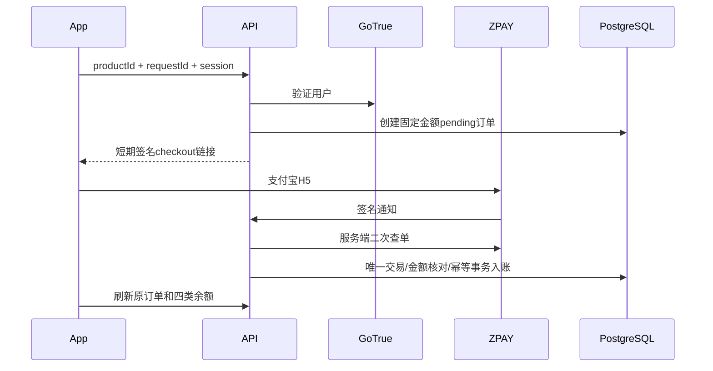

# 认证、订单与额度账本

App把会话交给业务API，API请求GoTrue `/user` 验证已确认邮箱与authenticated角色，不相信客户端userId、价格或管理员布尔值。邮箱OTP与密码哈希由GoTrue处理，SDK负责刷新。`iko_password_set` 只影响本人补设提示，不赋予权限。

通知必须按官方协议验签，再核商户、渠道、订单、交易号、整数分金额与已付状态；返回页无入账逻辑。重复/迟到通知按数据库唯一约束和事务幂等处理；关闭新购买开关不妨碍已存在订单结算。过期订单真实付款需服务端核实，不能凭本机过期状态丢弃款项。

模型请求以用户+requestId+输入digest幂等。claim/reserve后派发，已派发无论有效结果如何计1；明确未派发才释放。journal记录attempted/terminal，崩溃恢复不凭时间盲退已派发请求。容量保护为全局8、单账号2等约束，不自动换供应商重复收费。结算幂等防重复扣量，成功统计独立。

数据库只授业务角色所需表/函数权限。管理员调整、赠送、撤销需要理由、请求号和审计；撤销保留已用量与其它订单贡献。服务端时间和账本才是额度依据，付款结果页、APK包名、本机布尔值都不能授权。

供应商注册表用AES-GCM加密，revision防覆盖冲突；只向确认的官方HTTPS端点派发，Key不回传客户端。余额查询未接独立账务凭据的供应商应显示unsupported/手动来源，不伪造零余额或历史曲线。

根目录测试是合成store、mock HTTP和本地临时目录；真实PostgreSQL事务测试在 tests 下，需要独立空测试库。任何测试都不允许借用生产连接字符串。
